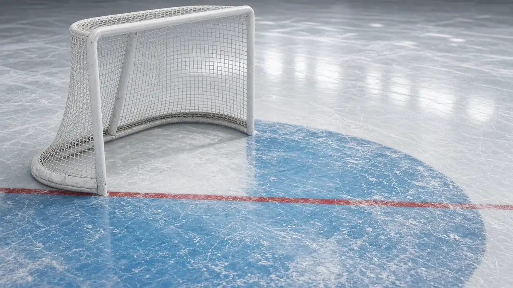

**Short answer: nobody is confirmed yet.** Monday, Nov. 2 is a light night on the [NHL schedule](https://www.nhl.com/schedule/2026-11-02), with only three games, and NHL.com's projected lineups have Andrei Vasilevskiy, John Gibson, Spencer Knight, Justus Annunen, Michael DiPietro and Joel Hofer all listed first in goal. None of the six has been named a starter by a team, the league or a reporter at the rink, so every one of them is **expected**, not confirmed. Daylight saving time ended Sunday, so all times below are Eastern Standard Time.

| Game (ET) | Away, last start | Home, last start |
|---|---|---|
| Lightning at Red Wings, 7 p.m. | Andrei Vasilevskiy, 29 saves through overtime in a 5-4 shootout loss to Nashville (Oct. 31) | John Gibson, 10 saves on 15 shots in a 5-4 loss to St. Louis (Oct. 31) |
| Blackhawks at Predators, 8 p.m. | Arvid Soderblom, 27 saves on 32 shots in a 5-4 overtime loss to Boston (Oct. 31) | Justus Annunen, 22 saves through overtime in a 5-4 shootout win over Tampa Bay (Oct. 31) |
| Bruins at Blues, 8 p.m. | Michael DiPietro, 37 saves on 41 shots in a 5-4 overtime win over Chicago (Oct. 31) | Joel Hofer, 24 saves on 28 shots in a 5-4 win over Detroit (Oct. 31) |

## Lightning at Red Wings, 7 p.m. ET

**Lightning: Andrei Vasilevskiy, expected.** [NHL.com's projected lineups](https://www.nhl.com/news/tampa-bay-lightning-detroit-red-wings-game-preview-november-2-2026) list him first in goal for Monday. He has not missed a start since Oct. 29 and made 29 saves through overtime in [Saturday's 5-4 shootout loss to Nashville](https://www.nhl.com/gamecenter/tbl-vs-nsh/2026/10/31/2026020219).

**Red Wings: John Gibson, expected.** Also [listed first](https://www.nhl.com/news/tampa-bay-lightning-detroit-red-wings-game-preview-november-2-2026) in NHL.com's projection. Gibson made just 10 saves on 15 shots in [Saturday's 5-4 loss to St. Louis](https://www.nhl.com/gamecenter/stl-vs-det/2026/10/31/2026020218).

## Blackhawks at Predators, 8 p.m. ET

**Blackhawks: Spencer Knight, expected.** [NHL.com's projection](https://www.nhl.com/news/chicago-blackhawks-nashville-predators-game-preview-november-2-2026) lists Knight first, with Arvid Soderblom second. That would be a rotation back to Knight, who has not started since Thursday, Oct. 29. Soderblom made 27 saves on 32 shots in [Saturday's overtime loss at Boston](https://www.nhl.com/gamecenter/chi-vs-bos/2026/10/31/2026020217). It is a projection, not an announcement, so treat it as unconfirmed until Chicago's morning skate.

**Predators: Justus Annunen, expected.** [Listed first](https://www.nhl.com/news/chicago-blackhawks-nashville-predators-game-preview-november-2-2026) after his 22-save overtime shootout win over Tampa Bay on Saturday.

## Bruins at Blues, 8 p.m. ET

**Bruins: Michael DiPietro, expected.** DiPietro made 37 saves on 41 shots to win in overtime against Chicago on Saturday, and [NHL.com's projected lineups](https://www.nhl.com/news/boston-bruins-st-louis-blues-game-preview-november-2-2026) list him first again for Monday.

<figure class="story-figure">
  
  <figcaption>AI-generated image</figcaption>
</figure>

**Blues: Joel Hofer, expected.** [Listed first](https://www.nhl.com/news/boston-bruins-st-louis-blues-game-preview-november-2-2026), with Jordan Binnington second, after Hofer made 24 saves on 28 shots in Saturday's win over Detroit.

## What we're watching

All six of Monday's projected starters come from NHL.com's projected lineups, which can and do change at the morning skate or later in the day. We will mark a name **confirmed** here and on the [Nov. 2 board](/nhl/starting-goalies/2026-11-02/) only once a team, the league, or a reporter at the rink says so, and we'll link the source. For how that process works, see [how NHL starting goalies get confirmed](/articles/how-nhl-starting-goalies-get-confirmed/).

Sunday's five-game slate is still working through confirmations of its own; see the [Nov. 1 board](/nhl/starting-goalies/2026-11-01/) and our write-up on [Tomkins and Brossoit](/articles/oilers-tomkins-ducks-brossoit-named-sunday-starters-nov-1-2026/). For the full day-by-day history, see the daily archive list on the [NHL starting goalies page](/nhl/starting-goalies/). Nothing here is betting or fantasy advice.
